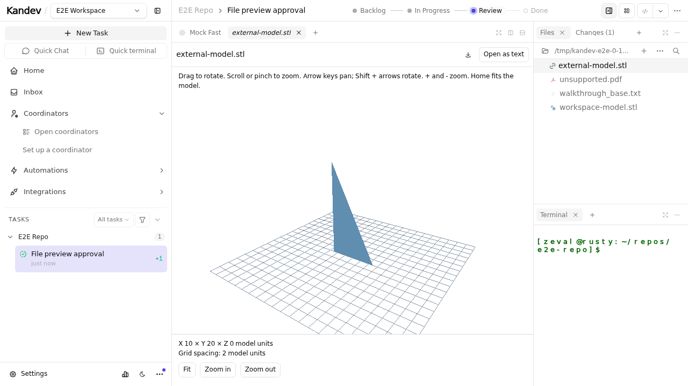
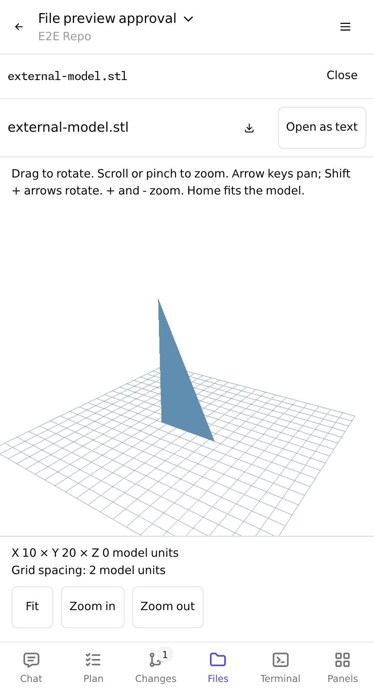

# Kandev STL viewer

A native Kandev file-viewer plugin for binary and ASCII STL models. Drag to
rotate, scroll or pinch to zoom, and use Fit to return to the whole model.
Keyboard controls work while the viewport has focus. Dimensions describe the
original model's axis-aligned bounding box. Grid spacing provides a scale.

STL stores no units. Dimensions and grid spacing use model units.

## Development status

The package requires Kandev `0.103.0` or later and uses plugin SDK `0.4.0`.
The UI rejects hosts without `registerFileViewer`. The STL package is not yet
published.

Source was created from `kdlbs/kandev-plugin-template` at
`be21ae09e091c73fd185244d678ecad4038291d0`. No template backend capabilities,
webhooks, configuration, or state access are used by the viewer.

## Build and test

Use Go 1.26 and a supported Node release. SDK dependencies resolve from their
public registries; packaging needs a checkout of the matching Kandev host.

```sh
npm ci --ignore-scripts
npm test
npm run check
npm run test:resource-limits
npm run build
go test -trimpath ./server
make verify-package-host KANDEV_TOOLING=/path/to/kandev/apps/backend
KANDEV_HOST_SOURCE=/path/to/kandev npm run test:package-smoke
```

The smoke test requires a fresh host backend and E2E web build, plus Chromium
runtime dependencies. It starts isolated host fixtures with temporary data.

Install the resulting `kandev-plugin-stl-0.1.0.tar.gz` in a disposable development
host through Settings > Plugins. It has no network model loader or CDN assets.
Select an STL file to load its preview. Approve external access when prompted.

The host limits source files to 64 MiB. The parser limits geometry to one million
triangles and runs in a worker with a ten-second deadline. One browser preview
owns the host allocation reservation at a time. See [Security](SECURITY.md).

## File access

Kandev supplies read-only bytes after host authorization. External files include
absolute paths and repository symlinks that resolve outside the selected root.
Ask is the default; Preview once applies to one selection. Allow and Deny are
host-owned settings for the current user, workspace, and plugin installation.
The plugin never reads a selected path through its executable or a webhook.

Native plugins remain trusted code, not sandboxed extensions. Installing this
plugin is an explicit trust decision. Its executable supplies only the managed
process required by the plugin contract.

### CI host and dependency audit

The package smoke test uses the supporting Kandev source revision in
`.kandev-tooling-ref`. It installs the real STL package and checks interactive
previews in chat and file panels on desktop and phone layouts. The pinned host
source is the commit for the declared minimum Stable release.

`make audit-recipes` checks all dependencies. Until 2026-12-18, it permits only
GHSA-fc5q-39xc-vjpf in development dependencies and its transitive reports.
As of 2026-11-18, picomatch has no patched release. Recipe tests use fixed,
repository-owned glob patterns. These tools do not ship in the plugin archive.
Production exposure, another high or critical advisory, an invalid audit result,
or an expired exception fails the check. Remove the exception when a fix is available.

### Screenshots

Captured by the installed-package test on desktop and phone layouts.




